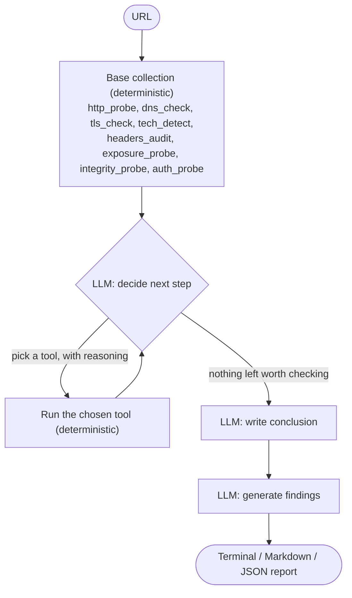

# Site Audit Agent

An agent that audits a website from a URL. It collects data with deterministic
tools, reads the result, and decides what to check next. Every finding in the
final report cites the tool output it came from.

A linear scanner reports every check with the same weight. This agent
investigates the way a person would: a canonical tag that names the `www` host
while the apex answers 200 on its own leads to a second request to `www`, not
to a generic warning.

**Use it only on sites you own or have written authorization to test.**
`audit` refuses to run without `--i-am-authorized`, which is your declaration
that you meet that condition. The flag is not a technical control and does not
verify ownership.

By default every tool is read-only: HTTP GET requests, DNS lookups and a TLS
handshake. No request sends credentials or changes anything on the target.
`--active` adds three more GET-only probes that send unusual input (a query
marker, an admin path, a malformed path) to test for injection, verbose
errors and open admin paths. See [Active mode](#active-mode-owasp-a01-a05-a10).

## Architecture



Every tool (HTTP, DNS, TLS, HTML parsing, PageSpeed) is plain Python with no
model involved. The model does three things: it picks the next tool and says
why, it interprets what a tool returned, and it writes the `explanation` and
`recommendation` text of each finding. It does not produce data. A value in a
report came from a tool call, and `Finding` validation drops any finding that
cites a tool that did not run (`schemas.py`, `findings.py`).

Finding generation is a separate phase. `agent.py` ends at a conclusion and
`findings.py` turns it into `Finding` objects, so a bug can be located in one
phase or the other.

The loop is written by hand in `agent.py`, with no agent framework.

Three details of the design:

- `wordpress_probe` and `vuln_check` are registered only after `tech_detect`
  confirms WordPress. A tool that does not apply is never offered to the model.
- The four security probes (`headers_audit`, `exposure_probe`,
  `integrity_probe`, `auth_probe`) run in the base collection. Nothing in the
  first four results hints at an exposed `.env` or a missing SRI hash, so a
  model choosing from that data would skip them and the OWASP coverage would
  change between runs.
- With `--active`, the same applies to `injection_probe`, `error_handling_probe`
  and `access_probe`: they join the base collection instead of being left to
  the model, for the same reason.

## Tools

| Tool | Collects |
|---|---|
| `http_probe` | Status, headers, redirects, TTFB, size |
| `tls_check` | Issuer, validity, days to expiry, protocol version |
| `dns_check` | A, AAAA, MX, TXT, NS, SPF, DMARC, CDN detection |
| `tech_detect` | CMS, framework, server, analytics, exposed versions |
| `headers_audit` | CSP, HSTS, X-Frame-Options, cookie flags, referrer policy |
| `exposure_probe` | `.env`, `.git/config`, wp-config backups, debug logs, open directory listing |
| `integrity_probe` | Third-party scripts and stylesheets without SRI |
| `auth_probe` | Session cookie flags, password forms served over HTTP |
| `content_probe` | Title, meta, headings, robots.txt, sitemap, canonical |
| `perf_probe` | PageSpeed Insights metrics |
| `wordpress_probe` | Version, REST users, XML-RPC, readme, plugins and themes in the HTML |
| `vuln_check` | Core, plugin and theme versions against the Wordfence CVE feed |
| `injection_probe` | Active, see below. Reflected marker and database error leakage |
| `error_handling_probe` | Active, see below. Stack traces and framework internals in error pages |
| `access_probe` | Active, see below. Common admin paths reachable without a login form |

## Output

`audit` prints findings grouped by severity, the OWASP coverage block, run
metrics and the decision trace. `--out` writes the Markdown report and
`--json-out` writes the same data for machines.

Each finding has a title, category, severity, explanation, recommendation,
effort, the evidence it cites and its OWASP tags. The decision trace lists
every tool call with its latency and the reasoning the model gave for it.

## Evals

`evals/` holds 8 fixtures, one planted problem each, covering 4 of the 5
finding categories the schema defines (security, performance, SEO,
availability; no fixture covers `maintenance` yet). There is no accessibility
category: this is a correctness and security scanner, not an a11y auditor.
Model responses are recorded once and replayed, so a normal test run uses no
network and no API credit.

| Fixture | Category | Planted problem |
|---|---|---|
| `expired_tls` | Security | Expired TLS certificate |
| `no_security_headers` | Security | Missing security headers |
| `wordpress_exposed_version` | Security | WordPress 5.2 exposed, user enumeration via REST |
| `high_ttfb` | Performance | Slow time-to-first-byte |
| `no_sitemap` | SEO | Missing `sitemap.xml` |
| `redirect_chain` | SEO / availability | Chained redirects |
| `healthy_site` | None | Clean site, zero problem-severity findings expected |
| `site_down` | Availability | Unreachable site |

- **Recall: 8/8.** Every planted problem was found, including the negative
  case: `healthy_site` produced no problem-severity finding.
- **Evidence integrity: 36/36.** Across the 8 cases the agent emitted 36
  findings in total, not just the one planted problem each, since several
  fixtures are realistic enough to also surface a real secondary issue. Every
  one of the 36 traced to a tool result actually collected in that run. None
  was dropped for citing data that was not collected.
- **Healthy-site case:** no problem-severity findings. The agent emitted one
  `info` finding ("checked, nothing wrong").

Each case is a single isolated problem; none combines two. 8 fixtures is a
small set, and more of them, not a reframing of these numbers, is the honest
way to make this claim stronger.

A "matching findings / total findings" precision figure is not reported. The
fixtures are realistic enough that the model also finds real secondary issues,
and a naive count would score those as noise.

Cost and latency are measured on every run and printed at the end. A typical
run takes 3 iterations and about 11 tool calls, with the cost on the order of
$0.07 at Sonnet list pricing, including the findings call.

## Guardrails

Every run has a ceiling, configurable through `.env`:

| Guardrail | Default |
|---|---|
| Max loop iterations | 12 |
| Max cost per run | $0.50 |
| Max tool calls | 30 |
| Global timeout | 180s |
| Per-tool timeout | 15s (45s for `perf_probe`, 60s for `exposure_probe`) |
| Authorization | `--i-am-authorized` required on every `audit` run |

Reaching any ceiling ends the run with `status: partial`. The cost ceiling is
checked inside the investigation loop. The findings call runs after it and
adds about $0.04 to $0.05. Requests carry an identifiable `User-Agent` that
links to this repository.

## OWASP Top 10:2025 mapping

Security findings carry the OWASP Top 10:2025 categories their evidence points
to, and every report ends with a coverage list of all ten. The tag comes from
a fixed map of evidence tool to category (`owasp.py`), not from the model.

| Tool | Category |
|---|---|
| `tls_check` | A04 Cryptographic Failures |
| `headers_audit`, `wordpress_probe`, `exposure_probe` | A02 Security Misconfiguration |
| `vuln_check` | A03 Software Supply Chain Failures |
| `auth_probe` | A07 Authentication Failures |
| `integrity_probe` | A08 Software or Data Integrity Failures |
| `access_probe` (active mode) | A01 Broken Access Control |
| `injection_probe` (active mode) | A05 Injection |
| `error_handling_probe` (active mode) | A10 Mishandling of Exceptional Conditions |

A06 and A09 are listed as "not assessed": no probe here, passive or active,
covers them. Insecure design is a property of decisions made while building
the site, not of its live traffic, and logging and alerting happen on
infrastructure this agent never sees. For the other eight, the coverage line
says whether the probe ran, because a probe that did not run proves nothing.
A probe that skipped, errored or could not reach the site counts as not run,
and an `info` finding does not count as a hit.

The tag follows the tool, not the content of the finding. Read it as an index
into the report, not as a classification of each issue.

`exposure_probe` reports a path only when the response matches a content
signature, so a site that answers 200 to everything is not flagged, and file
contents never reach the report. `integrity_probe` leaves out tag managers,
analytics and web fonts, since a pinned SRI hash would break them on the next
vendor update.

## Active mode (OWASP A01, A05, A10)

`audit --active` adds three probes on top of the passive set:

- `injection_probe` (A05): sends a unique marker in a query string and checks
  whether the response reflects it unescaped (reflected XSS) or leaks a
  database driver's own error text.
- `error_handling_probe` (A10): requests a path that cannot exist and a
  malformed path, and checks whether the error response leaks a stack trace,
  a file path or framework internals instead of a generic error page.
- `access_probe` (A01, partial): requests common admin paths (`/admin`,
  `/dashboard`, and similar) and reports which ones return content without a
  login form. It cannot tell whether a reachable path exposes another user's
  data, which would need an account on the target, so this covers only
  whether the path is open at all.

Every active request is still GET, sent to the audited host, and changes
nothing on the server. With `--active` the three run unconditionally, in the
base collection, the same way the passive security probes do: nothing in a
clean site's data gives the model a reason to reach for them on its own, so
leaving them to its judgment would make the coverage change from run to run.
Use `--active` only on a target where your authorization under
`--i-am-authorized` extends to this kind of testing.

## Known-CVE cross-referencing (optional)

`vuln_check` matches WordPress core, plugin and theme versions against the
Wordfence Intelligence vulnerability feed. The feed is free and needs an API
key. Without the feed file the tool returns `skipped`. The file is not
refreshed automatically; download it once and update it occasionally:

```bash
export WORDFENCE_API_KEY="..."  # wordfence.com > account > Integrations
python scripts/download_wordfence_feed.py
```

The file is about 150 MB (40,000 records) and loads in under a second.

## Installation and usage

```bash
git clone https://github.com/dujudini/site-audit-agent.git
cd site-audit-agent
python -m venv .venv
source .venv/bin/activate  # .venv\Scripts\activate on Windows
pip install -e ".[dev]"
cp .env.example .env
# put your ANTHROPIC_API_KEY in .env; GOOGLE_PAGESPEED_KEY is optional
```

```bash
# collection tools only, no LLM, no cost
audit-agent probe https://example.com

# full pipeline: loop, findings, report (your own site, or written permission)
audit-agent audit https://example.com --i-am-authorized --out report.md --json-out report.json

# add active probes (A01, A05, A10)
audit-agent audit https://example.com --i-am-authorized --active
```

```bash
pytest              # unit tests and evals, no network, no API cost
ruff check .
mypy src
```

Cassettes need re-recording only after a change to `prompts/report.md` or a
fixture. This makes real API calls at a small cost:

```bash
python evals/record_cassettes.py
```

## Known limitations

- Collection is unauthenticated and cannot see issues behind a login.
- The agent does not throttle itself or obey `robots.txt`. Requests run back to
  back, and `content_probe` only reports whether `robots.txt` and
  `sitemap.xml` exist.
- The model chooses which optional tools to run (`content_probe`, `perf_probe`
  and the WordPress ones), so two runs on the same site can cover different
  ground there. The active probes are forced into the base collection instead,
  so `--active` always runs all three. The OWASP coverage block shows what ran.
- `access_probe` only tests whether an admin path answers without a login
  form, not whether it belongs to the audited site owner or exposes real
  data. A custom login page it does not recognize can also read as open.
- `injection_probe` appends its marker to the URL as-is; a site with no query
  parameters at all gives it nothing realistic to test.
- `perf_probe` needs a Google PageSpeed key with its own quota. Without one it
  reports `skipped`.
- DNS goes through Cloudflare's DoH resolver, which is one public resolver's
  view and not the requesting host's own.
- `tls_check` does a real handshake. A corporate proxy or sandbox that
  intercepts TLS produces a real certificate error.
- HTML is read with regular expressions. Unusual markup, such as a `>` inside
  an attribute, can be misread.
- `integrity_probe` treats the last two host labels as the site's own domain.
  Suffixes such as `.com.br` are not handled without a public-suffix list.
- A plugin or theme whose version equals the WordPress core version is read as
  unknown, because the asset URL cannot tell them apart.
- Sitemaps are looked up at `/sitemap.xml`, `/sitemap_index.xml` and
  `/wp-sitemap.xml`. One declared only in `robots.txt` at another path is not
  found.
- Findings generation runs once per audit. If the model's output fails schema
  validation as a whole, report generation fails instead of degrading.
- Tool bugs can produce well-evidenced false findings. Evidence validation
  guarantees traceability to a tool result, not that the tool was right.
